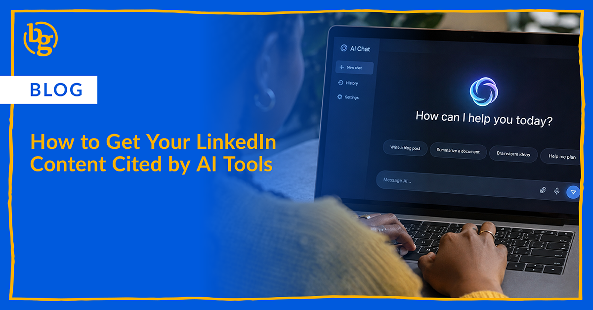
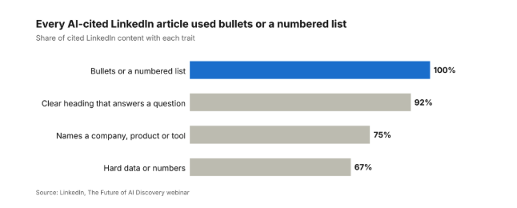
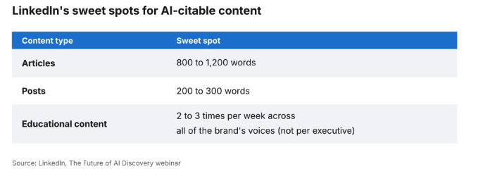

Your next customer might already know who you are before they ever land on your website. Or worse, they might have already crossed you off the list.

According to LinkedIn, 94% of B2B buying groups now use ChatGPT, Gemini or another LLM before they talk to a sales rep or visit a brand's website. They're using these tools to research solutions, build shortlists and narrow down who makes the cut.

So the big question for B2B marketers is: when a buyer asks an AI tool about your category, does your brand show up in the answer?

I recently joined LinkedIn's [The Future of AI Discovery](https://www.linkedin.com/smart-links/AQFn6Gc5_oaRTA/d49329d1-edf8-4f21-93a7-d4a173ae5042) webinar, and it was packed with useful data on exactly that. We've written before about [why LinkedIn and Reddit matter more than ever in the age of AI search](https://brandglue.com/blog/linkedin-reddit-ai-search/), and this webinar added a lot of hard data to that conversation. Here are my biggest takeaways, plus how we're already putting them to work for our clients at BrandGlue.

## **Why does LinkedIn matter so much for AI search?**

LinkedIn is the No. 2 most-cited source across LLM platforms and the No. 1 most-cited source for professional queries. If your buyers are asking AI tools work-related questions, there's a good chance the answer is pulling from LinkedIn.

A few things that stood out:

* **Any public organic LinkedIn content can be indexed and cited by LLMs.** Posts, articles, all of it.
* **Videos count too.** LinkedIn automatically creates transcripts, so your video content can be indexed just like text.
* **LLMs look for four main signals** when deciding what to include in an answer: experience, expertise, authority and trust.

That last point is a big one. It's basically the same thing your buyers are looking for. Content that shows real experience and expertise wins with both humans and machines.

## **What kind of LinkedIn content gets cited by AI?**

Educational content from real people. That's the short answer. Here's what the data showed:

* **75% of cited LinkedIn content comes from individuals, not company pages.** Your execs and SMEs are your biggest opportunity here. (We dug into why people-led content builds trust in [B2B Has a Credibility Problem. Creators Can Help Fix It.](https://brandglue.com/blog/b2b-credibility-problem-creators-help-fix-it/))
* **Long-form articles get 6.5x more citations than regular posts.**
* **Recent content wins.** Nearly half of the cited LinkedIn content had been published or updated in the previous 3 months.
* **Follower count isn't everything.** Helpful, credible content can get cited without going viral. That said, the LinkedIn rep mentioned they've seen people with at least 3K followers get cited more often.
* **Educational content is the "crown jewel."** Promotional posts, company announcements, award posts and general brand claims are much less likely to be cited, because they usually don't answer a question.

That last one might sting a little for brands that lean heavily on announcements. But it makes sense. AI tools are trying to answer questions, so content that actually answers them is what gets pulled in.

## **How should you structure LinkedIn content so AI can cite it?**

LinkedIn reviewed the content that's getting cited most and found some clear patterns:

They also stressed front-loading the answer. LLMs often pull from the first couple of sentences, so don't bury the good stuff under a long intro.

A couple of other tips I'm taking straight into our client work:

* **Use the actual company or product name at least once.** An AI tool might not know who "we" refers to.
* **Write headings in natural, question-based language.** Think about how a buyer would actually phrase the question, not your internal brand jargon or a stuffed keyword.

And if you're stuck on what to write, these formats tend to perform well:

1. "Best X" lists
2. Side-by-side comparisons
3. How-to or how-to-choose guides
4. Educational explainers
5. Original research and data-led thought leadership
6. FAQs

(You might notice this blog follows a lot of these rules. That's on purpose.)

## **Who should be posting, and how often?**

Your credible executives, creators and internal subject matter experts, posting from their personal profiles. They're the ones best positioned to answer your buyers' questions with real experience behind it.

One detail I found especially useful: **original posts from thought leaders are more likely to be cited than reshares or reposts.** For one of our B2B tech clients, we're already shifting their exec strategy to include more original posts, and I'd recommend the same for any brand with executives active on LinkedIn. If you're running an employee advocacy program, this is a good reason to encourage people to add their own take instead of just hitting share. For more ideas on getting execs involved, check out [How to Get More Social Media Mileage Out of Every Piece of B2B Content](https://brandglue.com/blog/social-media-mileage-b2b-content/).

LinkedIn's suggested sweet spots:

That frequency note is good news. You don't need every exec posting daily. You need a steady rhythm across your brand's voices combined.

## **Does engagement still matter for AI citations?**

Yes. Content needs to be structured so machines can understand it, but humans still need to find it useful. Comments, reactions, shares, reposts and dwell time all help build the credibility signals that can lead to citations.

And not all comments are equal. A thoughtful comment that adds to the conversation, or explains how someone plans to use the info, sends a much stronger signal than "Great post!" (I'm honestly curious how the wave of AI-generated comments will play into this, especially since LinkedIn started [ranking comments by relevance](https://brandglue.com/blog/the-buzz-brandglue-september-2026/) to help weed out AI slop.)

## **Can paid social help your content get cited?**

Indirectly, yes. LLMs generally ignore content they recognize as paid or sponsored, partly because they're starting to sell their own ads. So a standard sponsored post isn't going to get cited.

But boosting an existing organic post or running a Thought Leader Ad can still help. Paid amplification builds engagement and "signal density" around the original organic content, which can make it more likely to be indexed and cited.

In other words, paid and organic aren't separate strategies here. Paid is what gives your best organic content a bigger push.

## **The bottom line**

AI discovery isn't some far-off trend. Your buyers are already using it to decide who makes their shortlist. The good news is that what gets cited is basically good B2B content: helpful, specific, educational and coming from real people who know their stuff.

If you want to show up in those AI answers, start here:

1. Get your execs and SMEs posting original, educational content from their personal profiles
2. Use question-based headings and front-load the answer
3. Include real data and name your company, product or tool
4. Keep content fresh and publish 2 to 3 times a week across your brand's voices
5. Use Thought Leader Ads or boosts to build engagement around your best organic posts

Want help building a LinkedIn strategy that works for both your buyers and the AI tools they're using? [Let's chat](https://brandglue.com/contact/).
