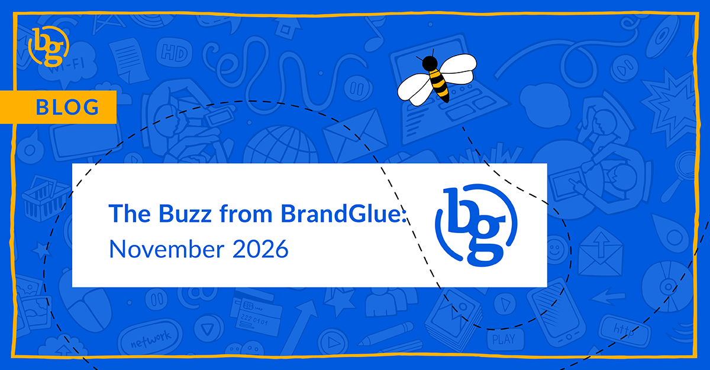

Lead gen was clearly the theme of November. X brought its Lead Gen Ads back from a nine-year nap, Reddit beefed up its B2B toolkit, and LinkedIn gave Thought Leader Ads headlines, CTA buttons, and lead forms. Meanwhile, more than half of YouTube watch time is now happening from the couch on a TV screen, Instagram finally lets you fix that Story typo, and Meta is (gasp) handing some control back to advertisers. Grab a coffee and scroll on. Here's everything you need to know before the holiday rush.

### [\> More Functionality for LinkedIn Thought Leader Ads](https://www.linkedin.com/help/linkedin/answer/a5964111)

Source: LinkedIn

Adding a headline, a call-to-action button with its own URL, and a lead gen form are some of the new options coming to the sponsored version of thought leader posts. These will only appear on the sponsored version that’s shown to the advertiser’s audience, and not the original organic one. It will be interesting to see if performance on these drops with these new options, since they will look more like, well, ads.

### [\> New Instagram Stories Features Released](https://www.instagram.com/p/Df5UIXBG9v3/?_sp=cc06daf1-c29b-4b7d-a692-e8e9284c481b.1795197343757&img_index=1)

Source: Creators Instagram

Instagram shared some new updates this month, and the one getting the most attention is that users can now edit their Stories up to 15 minutes after publishing. This will be very helpful for events where sometimes the need to post quickly ends up in deleting and reposting. Instagram also made it easier to select and post multiple images in your Stories.

### [\> Over Half of YouTube Watch Time Happens on a TV Screen](https://www.performancemarketingworld.com/article/1970571/youtubes-tv-era-half-watch-time-happens-tv-screens)

Source: Performance Marketing World

A recent study found that more than half of all UK YouTube watch time happens on a TV screen. Visuals, readable text, and good audio matter even more on a large screen, so make sure you aren’t skimping on those details. Also, you can’t click a link from a remote, so make sure to clearly say your CTA out loud.

### [\> Updated Reddit Lead Gen Ad Options](https://redditinc.com/news/reddit-launches-enhanced-capabilities-for-lead-generation)

Source: Reddit Inc.

Reddit is expanding its B2B lead gen tools. Advertisers can now get automated Max campaigns, in-market audiences for buyers researching things like enterprise AI and cybersecurity, a HubSpot integration, and pipeline attribution through Dreamdata and Octane 11.

### [\> Facebook: Choose an Audience for Each Ad Creative](https://www.jonloomer.com/choose-an-audience-for-each-ad-creative/)

Source: Jon Loomer

Reddit is expanding its B2B lead gen tools. Advertisers can now get automated Max campaigns, in-market audiences for buyers researching things like enterprise AI and cybersecurity, a HubSpot integration, and pipeline attribution through Dreamdata and Octane 11.

### [\> X Lead Gen Ads Launched Globally](https://x.com/XBusiness/status/2113427079471440040?_sp=cc06daf1-c29b-4b7d-a692-e8e9284c481b.1795202811625)

Source: X Business

After revamping its Lead Generation product earlier this year, X has announced that all advertisers globally can now run Lead Gen Ad campaigns in the app. The format is very similar to what Twitter used to offer, and it will be interesting to see if this version sticks around, since the original was retired in 2016 due to a lack of adoption.

**That’s a wrap on the updates!**

Join us again next month as we continue to bring you the latest and greatest updates to help you succeed in the B2B social media marketing community. In the meantime, follow us on [LinkedIn](https://www.linkedin.com/company/brandglue-com/posts/?feedView=all) for additional updates.
